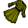
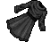
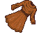
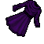

# Dungeon Dyes

Every dungeon in Britannia leaves its mark on those who spend enough time within its depths.

Monsters slain inside a dungeon have a rare chance to drop a Dungeon Dye Material.

Collect 100 of a material, load it into a Tailor Dye Kit, and you can craft a dye bottle that permanently colors clothing in that dungeon's signature hue. Two finished dye bottles can also be poured together into one of 24 blends.

A Tailoring Guidebook can be found in the world that documents the dungeon materials, their origins, and the dyes produced from them.

## Dye Material

This table shows which dungeon drops each Dye Material.

| Dungeon  |   Dye Material    |      Dye Name      |                            Hue Preview                             |
|:--------:|:-----------------:|:------------------:|:------------------------------------------------------------------:|
| Covetous |   Shimmerstone    |     Aurum Gold     | [ 2132](../hues/hue.md?id=2132) |
|  Deceit  |  Illusion Shard   |    Phantom Gray    | [ 2165](../hues/hue.md?id=2165) |
| Despise  |    Thorny Vine    |     Envy Green     | [ 2163](../hues/hue.md?id=2163) |
| Destard  | Dragon Blood Opal | Dragon's Scale Red | [ 2139](../hues/hue.md?id=2139) |
|   Fire   |    Cinderstone    |   Inferno Orange   | [ 2470](../hues/hue.md?id=2470) |
| Hythloth |   Shadow Stone    |   Abyssal Black    | [ 2724](../hues/hue.md?id=2724) |
|   Ice    |  Glacial Shards   |    Glacial Blue    | [ 2579](../hues/hue.md?id=2579) |
|  Shame   | Crystal of Regret |   Forlorn Violet   | [ 2149](../hues/hue.md?id=2149) |
|  Wrong   |  Ironweight Ore   |   Judgment Blue    | [ 2154](../hues/hue.md?id=2154) |
| Terathan Keep | Rosesilk Skein | Shaded Dusty Rose | [ 2144](../hues/hue.md?id=2144) |

Click any hue ID to preview the color on the [Hues](../hues/index.md) page.

Every dye material stacks, so you can split off part of a stack or drop one pile onto another to combine them.

Dye material can also be found in dungeon treasure chests (level 2 and up) opened with Lockpicking. For more information visit the [Dungeon Treasure Chests](../game-mechanics/dungeon-treasure-chests.md#dungeon-dye-material) page.

## Tailor Dye Kit

The Tailor Dye Kit is used with Dungeon Dye Materials to craft dyes.

To purchase one, you must first join the Tailor guild. You can join by using the command `[NPC name] join` and paying a fee of 5.000 gold to a Grandmaster Tailor NPC.

Once you're a member and have 100 Tailoring, you can obtain the Tailor Dye Kit by giving 10.000 gold to a Grandmaster Tailor NPC. Below 100 Tailoring the Grandmaster turns you away and keeps nothing.

## Craft a Dye Bottle

Double-click the Tailor Dye Kit to open the kit window. It has one row for each dungeon dye, showing how much of that material is in the kit and a **Craft** button.

To add material, press **Pour in all material** to empty every dye material in your backpack into the kit, press **Pour a stack** and target one stack, or drop a stack straight onto the kit. The kit tracks each material separately.

Crafting a bottle takes 100 of that dye's material and an empty bottle in your backpack. The bottle takes the dye's color, and single-clicking it shows the dye's name, who crafted it and the hue number.

Double-click a dye bottle and target clothing, sandals, or a tribal, savage, bear, deer, orcish kin, bone or orc mask in your backpack to dye it. Clothing a dye tub can't recolor, such as reward robes, shrouds and hoods, can't be dyed with a bottle either.

## Blends

The **Blends** tab of the kit window lists 24 blends. Each one is made from two dungeon dyes: one gives the garment its dark body, the other the glint on its folds.

To pour a blend, carry one bottle of each of its two dyes and press **Blend**. The bottles can be anywhere in your backpack, including inside a pouch. Both bottles are used up and you get one bottle of the blend. The window shows a robe and a mask in each blend's color, which of the two bottles you are carrying, and who poured it first on the shard.

After you pour a blend it needs 3 days to steep before you can pour another. That wait is shared by every character on all of your accounts. Crafting regular dungeon dyes is not limited.

The palette count in the kit window belongs to the character holding the kit. Each character keeps their own record of the blends they have poured, so pick one tailor to pour with if you are working towards all 24.

| Blend | Body | Glint | Hue |
|:-----:|:----:|:-----:|:---:|
| Frostfire | Inferno Orange | Glacial Blue | [ 2671](../hues/hue.md?id=2671) |
| Regal Amethyst | Forlorn Violet | Aurum Gold | [ 2672](../hues/hue.md?id=2672) |
| Twilight Glacier | Glacial Blue | Forlorn Violet | [ 2673](../hues/hue.md?id=2673) |
| Ember Rose | Inferno Orange | Shaded Dusty Rose | [ 2674](../hues/hue.md?id=2674) |
| Dragon's Verdict | Dragon's Scale Red | Judgment Blue | [ 2675](../hues/hue.md?id=2675) |
| Venomscale | Dragon's Scale Red | Envy Green | [ 2676](../hues/hue.md?id=2676) |
| Bloodfrost | Glacial Blue | Dragon's Scale Red | [ 2677](../hues/hue.md?id=2677) |
| Glacial Moss | Glacial Blue | Envy Green | [ 2678](../hues/hue.md?id=2678) |
| Molten Gold | Aurum Gold | Inferno Orange | [ 2679](../hues/hue.md?id=2679) |
| Wyrm Violet | Dragon's Scale Red | Forlorn Violet | [ 2680](../hues/hue.md?id=2680) |
| Penitent Rose | Judgment Blue | Shaded Dusty Rose | [ 2681](../hues/hue.md?id=2681) |
| Gilded Envy | Envy Green | Aurum Gold | [ 2682](../hues/hue.md?id=2682) |
| Smouldering Ash | Phantom Gray | Inferno Orange | [ 2683](../hues/hue.md?id=2683) |
| Shadow Amethyst | Abyssal Black | Forlorn Violet | [ 2684](../hues/hue.md?id=2684) |
| Dragon's Hoard | Dragon's Scale Red | Aurum Gold | [ 2685](../hues/hue.md?id=2685) |
| Abyssal Venom | Abyssal Black | Envy Green | [ 2686](../hues/hue.md?id=2686) |
| Frosted Rose | Glacial Blue | Shaded Dusty Rose | [ 2687](../hues/hue.md?id=2687) |
| Abyssal Rose | Abyssal Black | Shaded Dusty Rose | [ 2688](../hues/hue.md?id=2688) |
| Gilded Frost | Glacial Blue | Aurum Gold | [ 2689](../hues/hue.md?id=2689) |
| Nightshade | Envy Green | Forlorn Violet | [ 2690](../hues/hue.md?id=2690) |
| Dragonfire | Dragon's Scale Red | Inferno Orange | [ 2691](../hues/hue.md?id=2691) |
| Thornrose | Envy Green | Shaded Dusty Rose | [ 2692](../hues/hue.md?id=2692) |
| Violet Ember | Forlorn Violet | Inferno Orange | [ 2693](../hues/hue.md?id=2693) |
| Phantom Blood | Phantom Gray | Dragon's Scale Red | [ 2694](../hues/hue.md?id=2694) |

Blends made with Judgment Blue are the rarest, because Ironweight Ore is the scarcest material.

## Achievements

Dye achievements are earned by each character separately. The **Crafting / Dungeon Dyes** achievement category tracks:

- **Dyes of the Deep**: craft 1, 5, 10, 25 and 50 dungeon dye bottles. The last tier grants the title *Dungeon Dyer*
- **Every Dungeon's Colour**: craft 3, 6 and all 10 different dungeon dyes. The last tier grants *Colourist of the Depths*
- **Blends Poured**: pour 1, 5, 15 and 30 blends
- **The Full Palette**: pour 6, 12, 18 and all 24 different blends. The last tier grants *Master Dyer*
- **Worn Colours**: dye clothing in 1, 5 and 12 different blends. Anyone can earn this, not just the tailor who poured them
- **First Pour**: be the first on the shard to pour a blend
- **A Fair Verdict**: pour a blend made with Judgment Blue

## Item Descriptions

The Tailoring Guidebook describes each material:

**Covetous - Shimmerstone**

> A luminescent gem that radiates with a golden shine, said to be the solidified essence of greed. A tailor can refine this stone into a fine powder to create Aurum Gold Dye.

**Deceit - Illusion Shard**

> A fragment of crystal that distorts light, making the holder's outline appear blurred. Ground into a reflective dust for the crafting of Phantom Gray Dye.

**Despise - Thorn of Envy**

> A thorny vine with a natural, glowing green sap that pulses with a life of its own. The sap can be extracted and concentrated by a tailor to produce Envy Green Dye.

**Destard - Dragon's Blood Opal**

> A rare opal that bears the appearance of being stained with dragon's blood. Crushed into a fine pigment for Dragon's Scale Red Dye.

**Hythloth - Shadow Stone**

> A stone that seems to absorb light, making it appear darker than darkness itself. Its core can be used to infuse cloth with Abyssal Black Dye.

**Shame - Crystal of Regret**

> A purplish crystal that dims and brightens. Pulverized into a dust that creates Forlorn Violet Dye.

**Wrong - Ironweight Ore**

> A heavy, cold iron scale weight that once may have been used for measuring fines or punishments. Melted down and blended with special solutions to yield Judgment Blue Dye.

**Fire - Cinderstone**

> A volcanic rock warm to the touch, containing the fury of a dungeon's inferno. Ground Cinderstone is the primary ingredient for Inferno Orange Dye.

**Ice - Glacial Shards**

> The heart of a glacier - an icy fragment that never melts, perpetually radiating cold. Shavings from the core are perfect for creating Glacial Blue Dye.

**Terathan Keep - Rosesilk Skein**

> A skein of terathan silk stained the muted rose of the brood chambers it was spun in. Drawn out into thread, the skein yields Shaded Dusty Rose Dye.

## Related pages

- [Hues](../hues/index.md)
- [Dungeon of the Week](dotw.md)
- [Dungeon Treasure Chests](../game-mechanics/dungeon-treasure-chests.md)
