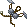
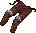
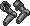
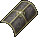

# Armor

The AR Area on this table shows the actual Armor Rating of the area it protects. It will not match the in-game character status window, which only displays the total average.

The numbers after the AR Area shows the contribution to the total AR average, as showed in the character status window.

## Leather

Looted Leather armor can't be repaired.

|                                    Armor                                     | STR Req. |   Slot    | AR Area | AR Contr. | Item HP |
|:----------------------------------------------------------------------------:|:--------:|:---------:|:-------:|:---------:|:-------:|
|        Leather Gorget       |    10    |   Neck    |   13    |    0.9    | 31 - 37 |
|        Leather Gloves       |    10    |   Hands   |   13    |    0.9    | 31 - 37 |
|           Leather Cap          |    15    |   Head    |   13    |    1.8    | 31 - 37 |
|       Leather Sleeves      |    10    |   Arms    |   13    |    1.9    | 31 - 37 |
|       Leather Bustier      |    15    | Arms/Body |   13    |    1.9    | 31 - 37 |
|  Female Leather Armor |    15    | Arms/Body |   13    |    1.9    | 31 - 37 |
|      Leather Leggings     |    10    | Legs/Feet |   13    |    2.9    | 31 - 37 |
|        Leather Shorts       |    10    | Legs/Feet |   13    |    2.9    | 31 - 37 |
|         Leather Skirt        |    10    | Legs/Feet |   13    |    2.9    | 31 - 37 |
|         Leather Tunic        |    15    |   Body    |   13    |    4.7    | 31 - 37 |

## Studded

|                                 Armor                                 | STR Req. |   Slot    | AR Area | AR Contr. |  Item HP  |
|:---------------------------------------------------------------------:|:--------:|:---------:|:-------:|:---------:|:---------:|
|    Studded Gorget    |    25    |   Neck    |   16    |    1.1    |  36 - 44  |
|    Studded Gloves    |    25    |   Hands   |   16    |    1.1    |  36 - 44  |
|   Studded Bustier   |    25    | Arms/Body |   16    |    2.4    | 101 - 115 |
|  Female Studded Armor |    35    | Arms/Body |   16    |    2.4    | 101 - 115 |
|   Studded Sleeves   |    25    |   Arms    |   16    |    2.4    |  36 - 44  |
|  Studded Leggings  |    35    | Legs/Feet |   16    |    3.5    |  36 - 44  |
|     Studded Tunic     |    35    |   Body    |   16    |    5.7    |  36 - 44  |

<!--
### Ranger

|            Armor             | STR Req. |   Slot    | AR Area | AR Contr. | Item HP |
|:----------------------------:|:--------:|:---------:|:-------:|:---------:|:-------:|
|  Ranger Armor Gloves (rare)  |    25    |   Hands   |   16    |    1.1    | 36 - 44 |
|  Ranger Armor Gorget (rare)  |    25    |   Neck    |   16    |    1.1    | 36 - 44 |
|   Ranger Armor Arms (rare)   |    25    |   Arms    |   16    |    2.4    | 36 - 44 |
| Ranger Armor Leggings (rare) |    35    | Legs/Feet |   16    |    3.5    | 36 - 44 |
|  Ranger Armor Tunic (rare)   |    35    |   Body    |   16    |    5.7    | 36 - 44 |
-->

## Ringmail

|                                 Armor                                  | STR Req. |   Slot    | AR Area | AR Contr. | Item HP |
|:----------------------------------------------------------------------:|:--------:|:---------:|:-------:|:---------:|:-------:|
|    Ringmail Gloves   |    20    |   Hands   |   22    |    1.5    | 41 - 51 |
|   Ringmail Sleeves  |    20    |   Arms    |   22    |    3.3    | 41 - 51 |
|  Ringmail Leggings |    20    | Legs/Feet |   22    |    4.8    | 41 - 51 |
|     Ringmail Tunic    |    20    |   Body    |   22    |    7.9    | 41 - 51 |

## Chainmail

|                                  Armor                                   | STR Req. |   Slot    | AR Area | AR Contr. | Item HP |
|:------------------------------------------------------------------------:|:--------:|:---------:|:-------:|:---------:|:-------:|
|      Chainmail Coif     |    20    |   Head    |   28    |    3.8    | 36 - 44 |
|  Chainmail Leggings |    20    | Legs/Feet |   28    |    6.2    | 46 - 58 |
|     Chainmail Tunic    |    20    |   Body    |   28    |   10.0    | 46 - 58 |

## Bone

Looted Bone armor can't be repaired.

|                             Armor                              | STR Req. |   Slot    | AR Area | AR Contr. | Item HP |
|:--------------------------------------------------------------:|:--------:|:---------:|:-------:|:---------:|:-------:|
|       Orc Helm      |    0     |   Head    |   20    |    2.7    | 31 - 70 |
|    Bone Gloves   |    40    |   Hands   |   30    |    2.1    | 26 - 30 |
|    Bone Helmet   |    40    |   Head    |   30    |    4.1    | 26 - 30 |
|      Bone Arms     |    40    |   Arms    |   30    |    4.4    | 26 - 30 |
|  Bone Leggings |    40    | Legs/Feet |   30    |    6.6    | 26 - 30 |
|     Bone Armor    |    40    |   Body    |   30    |   10.7    | 26 - 30 |

## Platemail

|                                     Armor                                      | STR Req. |   Slot    | AR Area | AR Contr. |  Item HP  |
|:------------------------------------------------------------------------------:|:--------:|:---------:|:-------:|:---------:|:---------:|
|               Bascinet              |    10    |   Head    |   18    |    2.4    | 101 - 115 |
|         Plate Gorget        |    30    |   Neck    |   40    |    2.8    |  51 - 65  |
|       Platemail Gloves      |    30    |   Hands   |   40    |    2.8    |  51 - 65  |
|            Close Helm           |    40    |   Head    |   30    |    4.1    |  46 - 58  |
|                 Helmet                |    40    |   Head    |   30    |    4.1    |  46 - 58  |
|             Norse Helm            |    40    |   Head    |   30    |    4.1    |  46 - 58  |
|  Plate Tunic (Female) |    45    | Arms/Body |   30    |    4.4    |  51 - 65  |
|             Plate Helm            |    40    |   Head    |   40    |    5.4    |  46 - 58  |
|         Platemail Arms        |    40    |   Arms    |   40    |    5.9    |  51 - 65  |
|         Platemail Legs        |    60    | Legs/Feet |   40    |    8.8    |  51 - 65  |
|        Platemail Tunic       |    60    |   Body    |   40    |   14.3    |  51 - 65  |

## Shields

This table shows the Armor Rating for each shield type.

For more information visit the [Parrying](../../skills/combat/parrying.md) page.

=== "Normal"

    |                           Shield Type                           | STR Required | AR  |  Item HP  |
    |:---------------------------------------------------------------:|:------------:|:---:|:---------:|
    |     Buckler    |      15      |  7  |  41 - 51  |
    |      Wooden     |      5       |  8  |  21 - 23  |
    |      Bronze     |      20      | 10  |  26 - 30  |
    |       Metal      |      10      | 11  |  36 - 44  |
    |  Metal Kite |      30      | 16  | 101 - 115 |
    |      Heater     |      30      | 23  |  31 - 37  |
    |       Order      |      0       | 30  | 101 - 115 |
    |       Chaos      |      0       | 32  | 101 - 115 |

=== "GM Made"

    |                           Shield Type                           | STR Required | AR  |  Item HP  |
    |:---------------------------------------------------------------:|:------------:|:---:|:---------:|
    |     Buckler    |      15      |  8  |  41 - 51  |
    |      Bronze     |      20      | 12  |  26 - 30  |
    |       Metal      |      10      | 13  |  36 - 44  |
    |  Metal Kite |      30      | 19  | 101 - 115 |
    |      Heater     |      30      | 27  |  31 - 37  |

=== "Defense"

    |                           Shield Type                           | STR Required | AR  |  Item HP  |
    |:---------------------------------------------------------------:|:------------:|:---:|:---------:|
    |     Buckler    |      15      | 12  |  41 - 51  |
    |      Wooden     |      5       | 13  |  21 - 23  |
    |  Metal Kite |      30      | 21  | 101 - 115 |

=== "Guarding"

    |                           Shield Type                           | STR Required | AR  |  Item HP  |
    |:---------------------------------------------------------------:|:------------:|:---:|:---------:|
    |     Buckler    |      15      | 17  |  41 - 51  |
    |      Wooden     |      5       | 18  |  21 - 23  |
    |  Metal Kite |      30      | 26  | 101 - 115 |

=== "Hardening"

    |                           Shield Type                           | STR Required | AR  |  Item HP  |
    |:---------------------------------------------------------------:|:------------:|:---:|:---------:|
    |     Buckler    |      15      | 22  |  41 - 51  |
    |      Wooden     |      5       | 23  |  21 - 23  |
    |  Metal Kite |      30      | 31  | 101 - 115 |

=== "Fortification"

    |                           Shield Type                           | STR Required | AR  |  Item HP  |
    |:---------------------------------------------------------------:|:------------:|:---:|:---------:|
    |     Buckler    |      15      | 27  |  41 - 51  |
    |      Wooden     |      5       | 28  |  21 - 23  |
    |  Metal Kite |      30      | 36  | 101 - 115 |

=== "Invulnerability"

    |                           Shield Type                           | STR Required | AR  |  Item HP  |
    |:---------------------------------------------------------------:|:------------:|:---:|:---------:|
    |     Buckler    |      15      | 32  |  41 - 51  |
    |      Wooden     |      5       | 33  |  21 - 23  |
    |  Metal Kite |      30      | 41  | 101 - 115 |
