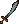
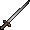
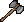
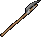
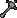
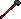
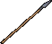

## Weapons

These tables do not take into account the Strength, Dexterity and Tactics of the attacker or the Armor Rating of the defender.

Weapons are considered being at full durability.

## Swordsmanship

=== "One Handed"

    |                              Weapon                              | STR Required |   Damage roll    | Speed | Item HP  |
    |:----------------------------------------------------------------:|:------------:|:----------------:|:-----:|:--------:|
    |  Skinning Knife |      5       |  1d10 (1-10)  |  40   | 31 - 40  |
    |         Cleaver        |      10      | 1d12+1 (2-13) |  40   | 31 - 50  |
    |   Butcher Knife  |      5       |  2d7 (2-14)   |  40   | 31 - 40  |
    |         Pickaxe        |      25      |  1d15 (1-15)  |  35   | 31 - 60  |
    |          Katana         |      10      | 3d8+2 (5-26)  |  58   | 31 - 90  |
    |         Cutlass        |      10      | 2d12+4 (6-28) |  45   | 31 - 70  |
    |     Broad Sword    |      25      | 2d13+3 (5-29) |  45   | 31 - 100 |
    |        Scimitar       |      10      | 2d14+2 (4-30) |  43   | 31 - 90  |
    |      Long Sword     |      25      | 2d15+3 (5-33) |  35   | 31 - 90  |
    |       Longsword      |      25      | 2d15+3 (5-33) |  35   | 31 - 90  |
    |    Viking Sword   |      40      | 4d8+2 (6-34)  |  30   | 31 - 90  |

=== "Two Handed"

    |                                Weapon                                | STR Required |   Damage roll    | Speed | Item HP  |
    |:--------------------------------------------------------------------:|:------------:|:----------------:|:-----:|:--------:|
    |           Hatchet          |      15      | 1d16+1 (2-17) |  40   | 31 - 80  |
    |  Executioner's Axe |      35      | 3d10+3 (6-33) |  37   | 31 - 90  |
    |               Axe              |      35      | 3d10+3 (6-33) |  37   | 31 - 100 |
    |        Double Axe       |      45      | 1d31+4 (5-35) |  37   | 31 - 110 |
    |  Large Battle Axe |      40      | 2d17+4 (6-38) |  30   | 31 - 110 |
    |        Battle Axe       |      40      | 2d17+4 (6-38) |  30   | 31 - 80  |
    |    Two-handed Axe   |      35      | 2d18+3 (5-39) |  30   | 31 - 70  |
    |          Bardiche         |      40      | 2d20+3 (5-43) |  26   | 31 - 100 |
    |           Halberd          |      45      | 2d23+3 (5-49) |  25   | 31 - 80  |

## Mace Fighting

=== "One Handed"

    |                             Weapon                             | STR Required |    Damage roll     | Speed | Item HP  |
    |:--------------------------------------------------------------:|:------------:|:------------------:|:-----:|:--------:|
    |     Magic Wand    |      0       |   2d3 (2 - 6)   |  35   | 31 - 70  |
    |  Smith's Hammer |      30      |  6d3 (6 - 18)   |  30   | 31 - 60  |
    |           Club          |      10      | 4d5+4 (8 - 24)  |  40   | 31 - 40  |
    |        War Axe       |      35      | 6d4+3 (9 - 27)  |  40   | 31 - 80  |
    |           Maul          |      20      | 5d5+5 (10 - 30) |  30   | 31 - 70  |
    |       War Mace      |      30      | 5d5+5 (10 - 30) |  32   | 31 - 110 |
    |           Mace          |      20      | 6d5+2 (8 - 32)  |  30   | 31 - 70  |
    |    Hammer Pick   |      35      | 3d10+3 (6 - 33) |  30   | 31 - 70  |

=== "Two Handed"

    |                              Weapon                               | STR Required |    Damage roll     | Speed | Item HP  |
    |:-----------------------------------------------------------------:|:------------:|:------------------:|:-----:|:--------:|
    |  Shepherd's Crook |      10      |  3d4 (3 - 12)   |  30   | 31 - 50  |
    |    Quarterstaff    |      30      | 5d5+3 (8 - 28)  |  48   | 31 - 60  |
    |   Gnarled Staff   |      20      | 5d5+5 (10 - 30) |  33   | 31 - 50  |
    |     Black Staff     |      35      | 5d6+3 (8 - 33)  |  35   | 31 - 70  |
    |      War Hammer      |      40      | 7d5+1 (8 - 36)  |  31   | 31 - 110 |

## Fencing

=== "One Handed"

    |                       Weapon                        | STR Required |    Damage roll     | Speed | Item HP  |
    |:---------------------------------------------------:|:------------:|:------------------:|:-----:|:--------:|
    |   Dagger   |      1       |  3d5 (3 - 15)   |  55   | 31 - 50  |
    |    Kryss    |      10      | 1d26+2 (3 - 28) |  53   | 31 - 90  |
    |  War Fork |      35      | 1d29+3 (4 - 32) |  45   | 31 - 110 |

=== "Two Handed"

    |                           Weapon                           | STR Required |    Damage roll     | Speed | Item HP |
    |:----------------------------------------------------------:|:------------:|:------------------:|:-----:|:-------:|
    |    Pitchfork   |      15      |  4d4 (4 - 16)   |  45   | 31 - 60 |
    |  Short Spear |      15      | 2d15+2 (4 - 32) |  50   | 31 - 70 |
    |        Spear       |      30      |  2d18 (2 - 36)  |  46   | 31 - 80 |

## Archery

|                              Weapon                              |                      Ammo                       | STR Required |     Damage roll     | Speed | Item HP  |
|:----------------------------------------------------------------:|:-----------------------------------------------:|:------------:|:-------------------:|:-----:|:--------:|
|             Bow            |  Arrows |      20      |  4d9+5 (9 - 41)  |   -   | 31 - 60  |
|        Crossbow       |   Bolts  |      30      |  5d8+3 (8 - 43)  |   -   | 31 - 80  |
|  Heavy Crossbow |   Bolts  |      40      | 5d10+6 (11 - 56) |   -   | 31 - 100 |
