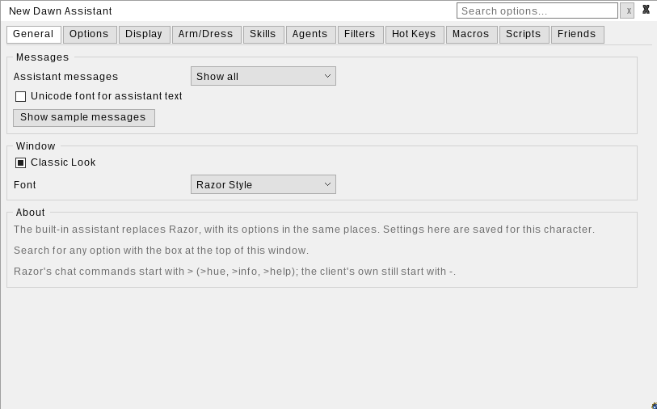
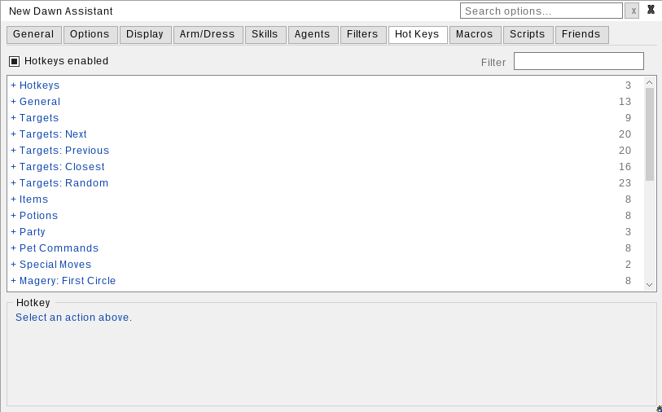

# Built-in Assistant

The New Dawn client has an assistant built in. It's Razor, rebuilt inside the client: the same tabs, the same options, the same names, all in the same places. Razor already works well, so the goal wasn't to reinvent it. The goal was to make it part of the client.

!!! tip "Used Razor before?"
    Then you already know how to use this. Every tab, checkbox and hotkey is where you'd expect to find it. The only real change is the look: it's drawn by the client instead of being a separate Windows program.

## Why build it?

I've maintained Razor since 2018. It's an amazing tool. It was written in the early 2000s, and it's still the main assistant for a lot of players today, including on some of the largest shards.

Its age shows in a few places, though:

- It's built on WinForms, which ties it to Windows
- Getting it running anywhere else is limited and takes extra work
- It has to bootstrap the client to load
- It gives the shard little control over what a player can or can't do with it

Building an assistant into the client has been a long-term goal. I had no desire to make a new assistant with a new name and features that are different for the sake of it. I wanted two things:

1. A quick way for players who aren't on Windows to get New Dawn installed
2. An easy way for someone who has used Razor for 25 years to keep the familiarity they love about the game

That's why it looks, feels and works like Razor.

## Turning it on

1. Disable Razor in the launcher
2. Start the client normally and log in
3. Click **Assistant** on the top bar

If you're on Linux or Mac and launch the client with command-line parameters, add this parameter so Razor doesn't load and the assistant turns on:

```bash
-plugins ""
```

You can also open it with the `-assistant` command, or bind the **Open Assistant Window** hotkey (under General on the Hot Keys tab). That hotkey has no key by default.

!!! note "Disabled while Razor is loaded"
    The built-in assistant turns itself off whenever Razor, or any other plugin, is loaded. If you see "The built-in assistant is disabled while Razor is loaded.", turn Razor off in the launcher and restart the client.

{ .center-img }

## Everything where you left it

The tabs follow Razor's order and layout. Most options sit in the same group box, under the same name.

| Tab       | Sub-tabs                                                                          | What's there                                                                                                                            |
| --------- | --------------------------------------------------------------------------------- | --------------------------------------------------------------------------------------------------------------------------------------- |
| General   |                                                                                   | Assistant messages, window look and font                                                                                                |
| Options   | Speech & Messages, Targeting & Queues, Additional Options                         | Message hues, container labels, last target queueing and range checks, smart targeting, blocks, stealth steps, auto unequip for potions |
| Display   | Display, Counters, Bandage Timer, Overhead Messages, Waypoints, Buffs / Cooldowns | Title bar stats, counters, bandage timer, overhead messages, waypoints, buff and debuff messages                                        |
| Arm/Dress |                                                                                   | Dress lists and undress bag                                                                                                             |
| Skills    |                                                                                   | Skill table with +/-, caps, locks, copy and skill logging                                                                               |
| Agents    |                                                                                   | Sell, Scavenger, Use Once, Buy, Organizer and Restock                                                                                   |
| Filters   | General, Text & Messages, Sound & Music, Target Filter                            | Sound groups, text and message filters, sound filter, target filter                                                                     |
| Hot Keys  |                                                                                   | Every action, grouped by category, with the same names Razor uses                                                                       |
| Macros    | Macros, Options                                                                   | Record, play, loop, step through, Pause/Wait, If, For and While                                                                         |
| Scripts   | Scripts, Options                                                                  | Script editor, recording, script variables                                                                                              |
| Friends   |                                                                                   | Friends groups, tags and party options                                                                                                  |

!!! tip
    - Hotkey actions use Razor's wording, word for word: Last Target, Target Self, Next Monster Target, Drink Heal, All Kill and so on
    - Razor's chat commands still start with `>` (`>info`, `>hue`, `>boat`, `>help`), while the client's own commands still start with `-`

## What's better

- **Cross-platform, nothing extra.** Because it's part of the client, it runs on every platform New Dawn supports, with nothing extra to install or set up
- **Integrated.** There's no separate program to start or attach, and no window that ends up behind the game. Click **\_** to minimize it to a small status bar that shows the running macro or script, recording, the bandage timer and whether hotkeys are on
- **Search.** The search box at the top finds any option by name, description or hotkey, then opens its tab and highlights it
- **Floating buttons.** Right-click any hotkey, macro or script and choose **Create button** to put a button on screen
- **Your look.** Classic Look (on by default) gives the light, Razor-like window. Turn it off for the dark theme. You can also pick the font, with Razor Style as the default
- **Macros and scripts work the same way.** Macros are scripts, so anything a script can do, a macro can do too. Every macro category is listed, and renaming a macro keeps its hotkey
- **Autocomplete.** The script editor completes commands as you type, or on ++ctrl+space++, with a usage example for each one
- **Named agents.** Buy, Organizer and Restock agents have names and there's no limit on how many you make, instead of a fixed set of numbered slots
- **Targeting that always works.** Next, Previous, Closest and Random work for every list and body type
- **Saved per character** with your client profile: hotkeys, agents, dress lists, friends, filters, counters and window position

{ .center-img }

## Coming from Razor

- **Macros come with you.** Drop your Razor `.macro` files into `Data\Scripts\Macros` in the client folder and they're converted when you open the Macros tab (or right-click and choose **Refresh Macro List**). The original is kept as `.macro.bak`. Any line that couldn't be converted is kept as a `// [not converted]` comment so you can fix it by hand
- **Copy and paste works too.** Copy a Razor macro, then click **New...** on the Macros tab and it offers to convert it
- **Settings don't come with you.** Razor profiles aren't imported, so your options, hotkeys and agents need setting up once
- **Where scripts live:**
  - Shared by all characters: `Data\Scripts\` in the client folder
  - For one character: the `Scripts` folder in that character's profile folder
  - Macros go in a `Macros` folder inside either one

## What's not here

A few Razor features were left out because the client already does the same job:

- Damage tracker, and damage dealt/taken messages
- Party mana and stamina overhead
- Death screen filter
- Low counter warning
- Gold tracker and its title bar tokens
- Display Counters (use the client's counter bar)
- Emote sounds

Also:

- Spell hotkeys cover Magery only
- There is no unequip-before-casting option. The New Dawn server already clears your hands when you cast

## Scripting and full feature reference

There's no reason to create a brand new help guide. This assistant, as mentioned above, is designed to replicate Razor, so you can simply use the existing Razor documentation.

!!! info "Use the Razor CE guide"
    The assistant follows Razor Community Edition's features and script language, so the [Razor CE guide](https://www.razorce.com/guide) covers scripting commands, expressions and how every feature works. This page doesn't repeat it.

## Related pages

- [Custom Art & Gumps](client-customizations.md)
- [Patch 1.18](../patches/patch-1.18.md)
- Installation on [Windows](on-windows.md) or [Linux](on-linux.md)
