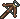
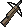

{ align=right }

# Archery

## Overview

Archery allows you to fight from a distance using bows and crossbows, this skill excels at kiting enemies and provides a significant safety advantage.

To help make Archers more viable, the shooting delay was reduced to 500ms and the Snare ability was added.

Starting items if you choose this skill in character creation: Bow, Arrows.

<!-- Not clear if all weapons have the same delay between shots -->

## Weapons and ammo

This table doesn't take into account the Strength, Dexterity and Tactics of the attacker or the Armor Rating of the defender.

Weapons are considered being at full durability.

|                              Weapon                              |                      Ammo                       | STR Required |     Damage roll     | Speed | Item HP  |
|:----------------------------------------------------------------:|:-----------------------------------------------:|:------------:|:-------------------:|:-----:|:--------:|
|             Bow            |  Arrows |      20      |  4d9+5 (9 - 41)  |   -   | 31 - 60  |
|        Crossbow       |   Bolts  |      30      |  5d8+3 (8 - 43)  |   -   | 31 - 80  |
|  Heavy Crossbow |   Bolts  |      40      | 5d10+6 (11 - 56) |   -   | 31 - 100 |

## Snare

While Snare is ready, an arrow or bolt that hits can pin your target in place. They can't walk, but they can still attack, cast spells, drink potions and bandage.

It requires at least 80 Archery and 80 Anatomy.

Type **[snare** or double-click your equipped bow to ready it, and do the same again to lower it. A buff icon shows while it's ready. It stays ready after a snare, and taking your bow off lowers it.

### When it goes off

Each hit has a chance to snare equal to (Archery + Anatomy) / 4 percent: 40% at 80/80 and 50% at 100/100. A hit that doesn't snare costs nothing and neither of you gets a message.

A snare costs 10 stamina, and only when it lands.

### What it does

- The target can't walk for 3 seconds (1.5 seconds for bosses)
- Any spell the target was casting is broken
- You can't snare again for 20 seconds. The buff icon counts this down

Once a target has been pinned, by a snare or a shield bash, it can't be pinned again until 8 seconds after it's free. Hits on it during that time don't use up your snare.

## Training

Train from Bowyer NPCs to reach around 50.

To gain you will need to repeatedly attack a target, use the razor scavenger to pick up the used arrows from the ground.

While training this skill you can also gain Dexterity (primary) and Strength (secondary). Visit the [stats](../../game-mechanics/character/stats.md) page to learn more.

## Related skills

- [Anatomy](anatomy.md)
