{ align=right }

# Carpentry

## Overview

Carpentry allows you to craft wooden furniture and instruments.

Starting items if you choose this skill in character creation: Half Apron, Saw, Boards.

## Tools

In order to start crafting, you will need a Saw tool, you can purchase one from carpenters vendors.

## Crafting list

These are all of the furniture, containers, instruments etc. you can craft.

=== "Other"

    |                                        Item                                        |     Resources     | Dyeable |     Skill      |
    |:----------------------------------------------------------------------------------:|:-----------------:|:-------:|:--------------:|
    |            Barrel Staves           | 5 Boards or Logs  |   no    | 0.0 Carpentry  |
    |               Barrel Lid              | 4 Boards or Logs  |   no    | 11.0 Carpentry |
    |  Short Music Stand (left) | 15 Boards or Logs |   yes   | 78.9 Carpentry |
    |   Tall Music Stand (left)  | 20 Boards or Logs |   yes   | 81.5 Carpentry |
    |             Easel (south)            | 20 Boards or Logs |   no    | 86.8 Carpentry |

=== "Furniture"

    |                                        Item                                        |            Resources             | Dyeable |              Skill               |
    |:----------------------------------------------------------------------------------:|:--------------------------------:|:-------:|:--------------------------------:|
    |               Foot Stool              |         9 Boards or Logs         |   yes   |          11.0 Carpentry          |
    |                    Stool                   |         9 Boards or Logs         |   yes   |          11.0 Carpentry          |
    |              Straw Chair             |        13 Boards or Logs         |   yes   |          21.0 Carpentry          |
    |             Wooden Chair            |        13 Boards or Logs         |   yes   |          21.0 Carpentry          |
    |          Vesper Style Chair         |        15 Boards or Logs         |   yes   |          42.1 Carpentry          |
    |         Trinsic Style Chair        |        15 Boards or Logs         |   yes   |          42.1 Carpentry          |
    |             Wooden Bench            |        17 Boards or Logs         |   yes   |          52.6 Carpentry          |
    |            Wooden Throne           |        17 Boards or Logs         |   yes   |          52.6 Carpentry          |
    |       Magincia Style Throne      |        19 Boards or Logs         |   yes   |          73.6 Carpentry          |
    |             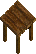 Small Table             |        17 Boards or Logs         |   yes   |          42.1 Carpentry          |
    |           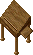 Writing Table           |        17 Boards or Logs         |   yes   |          63.1 Carpentry          |
    |             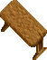 Large Table             |        23 Boards or Logs         |   yes   |          63.1 Carpentry          |
    |          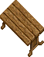 Yew-Wood Table          |        27 Boards or Logs         |   yes   |          84.2 Carpentry          |
    |                 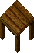 Counter                 |      22 Oak Boards or Logs       |   no    |          84.2 Carpentry          |
    |         Counter Top Only        |      22 Oak Boards or Logs       |   no    |          84.2 Carpentry          |
    |          Counter (Purple)         | 22 Oak Boards or Logs 5 Cloth |   no    | 88.6 Carpentry 84.2 Tailoring |
    |          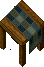 Counter (Green)          | 22 Oak Boards or Logs 5 Cloth |   no    | 88.6 Carpentry 84.2 Tailoring |
    |  Counter Top Only (Green) | 22 Oak Boards or Logs 5 Cloth |   no    | 88.6 Carpentry 84.2 Tailoring |

=== "Containers"

    |                             Item                             |                     Resources                     | Dyeable |     Skill      |
    |:------------------------------------------------------------:|:-------------------------------------------------:|:-------:|:--------------:|
    |    Wooden Box   |                 10 Boards or Logs                 |   yes   | 21.0 Carpentry |
    |   Small Crate  |                 8 Boards or Logs                  |   yes   | 10.0 Carpentry |
    |  Medium Crate |                 15 Boards or Logs                 |   yes   | 31.5 Carpentry |
    |   Large Crate  |                 18 Boards or Logs                 |   yes   | 47.3 Carpentry |
    |  Wooden Chest |                 20 Boards or Logs                 |   yes   | 73.6 Carpentry |
    |  Wooden Shelf |                 25 Boards or Logs                 |   yes   | 31.5 Carpentry |
    |  Armoire (Red) |                 35 Boards or Logs                 |   yes   | 84.2 Carpentry |
    |       Armoire      |                 35 Boards or Logs                 |   yes   | 84.2 Carpentry |
    |           Keg          | 3 Barrel Staves 1 Barrel Hoops 1 Barrel Lid |   no    | 57.8 Carpentry |

=== "Weapons and Armor"

    |                               Item                                |          Resources          | Dyeable |              Skill               |
    |:-----------------------------------------------------------------:|:---------------------------:|:-------:|:--------------------------------:|
    |  Shepherd's Crook |      7 Boards or Logs       |   no    |          78.9 Carpentry          |
    |    Quarter Staff   |      6 Boards or Logs       |   no    |          73.6 Carpentry          |
    |   Gnarled Staff   |      7 Boards or Logs       |   no    |          78.9 Carpentry          |
    |    Fishing Pole    | 5 Boards or Logs 5 Cloth |   no    | 68.4 Carpentry 40.0 Tailoring |
    |   Wooden Shield   |      9 Boards or Logs       |   no    |          52.6 Carpentry          |

=== "Instruments"

    |                                   Item                                   |           Resources           | Dyeable |                Skill                |
    |:------------------------------------------------------------------------:|:-----------------------------:|:-------:|:-----------------------------------:|
    |            Lap Harp           | 20 Boards or Logs 10 Cloth |   no    | 63.1 Carpentry 45.0 Musicianship |
    |       Standing Harp      | 35 Boards or Logs 15 Cloth |   no    | 78.9 Carpentry 45.0 Musicianship |
    |                Drum               | 20 Boards or Logs 10 Cloth |   no    | 57.8 Carpentry 45.0 Musicianship |
    |                Lute               | 25 Boards or Logs 10 Cloth |   no    | 68.4 Carpentry 45.0 Musicianship |
    |          Tambourine         | 15 Boards or Logs 10 Cloth |   no    | 57.8 Carpentry 45.0 Musicianship |
    |  Tambourine (tassel) | 15 Boards or Logs 15 Cloth |   no    | 57.8 Carpentry 45.0 Musicianship |

=== "Misc. Add-Ons"

    |                                    Item                                    |             Resources             | Dyeable |              Skill               |
    |:--------------------------------------------------------------------------:|:---------------------------------:|:-------:|:--------------------------------:|
    |    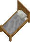 Small Bed (south)    |  100 Boards or Logs 100 Cloth  |   no    | 94.7 Carpentry 75.0 Tailoring |
    |     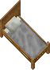 Small Bed (east)     |  100 Boards or Logs 100 Cloth  |   no    | 94.7 Carpentry 75.0 Tailoring |
    |    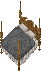 Large Bed (south)    |  150 Boards or Logs 150 Cloth  |   no    | 94.7 Carpentry 75.0 Tailoring |
    |    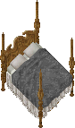 Large Bed  (east)     |  150 Boards or Logs 150 Cloth  |   no    | 94.7 Carpentry 75.0 Tailoring |
    |    Dart Board (south)    |         5 Boards or Logs          |   no    |          15.7 Carpentry          |
    |     Dart Board (east)     |         5 Boards or Logs          |   no    |          15.7 Carpentry          |
    |          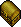 Ballot Box          |         5 Boards or Logs          |   no    |          47.3 Carpentry          |
    |            Pentagram           |  100 Boards or Logs 40 Ingots  |   no    |  100.0 Carpentry 75.0 Magery  |
    |             Abattoir            |  100 Boards or Logs 40 Ingots  |   no    |  100.0 Carpentry 50.0 Magery  |
    |         Water Barrel        | 5 Barrel Staves 2 Barrel Hoops |   no    |          57.8 Carpentry          |
    |  Water Barrel (short) | 3 Barrel Staves 1 Barrel Hoops |   no    |          57.8 Carpentry          |

=== "Blacksmithing"

    |                                   Item                                   |           Resources            | Dyeable |                Skill                 |
    |:------------------------------------------------------------------------:|:------------------------------:|:-------:|:------------------------------------:|
    |         Small Forge        | 5 Boards or Logs 75 Ingots  |   no    | 73.6 Carpentry 75.0 Blacksmithing |
    |  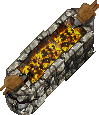 Large Forge (east)  | 5 Boards or Logs 100 Ingots |   no    | 78.9 Carpentry 80.0 Blacksmithing |
    | 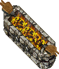 Large Forge (south) | 5 Boards or Logs 100 Ingots |   no    | 78.9 Carpentry 80.0 Blacksmithing |
    |         Anvil (east)        | 5 Boards or Logs 150 Ingots |   no    | 73.6 Carpentry 75.0 Blacksmithing |
    |        Anvil (south)       | 5 Boards or Logs 150 Ingots |   no    | 73.6 Carpentry 75.0 Blacksmithing |

=== "Training"

    |                                       Item                                       |           Resources           | Dyeable |              Skill               |
    |:--------------------------------------------------------------------------------:|:-----------------------------:|:-------:|:--------------------------------:|
    |    Training Dummy (east)   | 55 Boards or Logs 60 Cloth |   no    | 68.4 Carpentry 50.0 Tailoring |
    |   Training Dummy (south)  | 55 Boards or Logs 60 Cloth |   no    | 68.4 Carpentry 50.0 Tailoring |
    |   Pickpockets Dip (east)  | 65 Boards or Logs 60 Cloth |   no    | 73.6 Carpentry 50.0 Tailoring |
    |  Pickpockets Dip (south) | 65 Boards or Logs 60 Cloth |   no    | 73.6 Carpentry 50.0 Tailoring |

=== "Tailoring and Cooking"

    |                                      Item                                      |           Resources           | Dyeable |              Skill               |
    |:------------------------------------------------------------------------------:|:-----------------------------:|:-------:|:--------------------------------:|
    |           Dressform          | 25 Boards or Logs 10 Cloth |   yes   | 63.1 Carpentry 65.0 Tailoring |
    |   Spinning Wheel (east)  | 75 Boards or Logs 25 Cloth |   no    | 73.6 Carpentry 65.0 Tailoring |
    |  Spinning Wheel (south) | 75 Boards or Logs 25 Cloth |   no    | 73.6 Carpentry 65.0 Tailoring |
    |            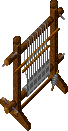 Loom (east)            | 85 Boards or Logs 25 Cloth |   no    | 84.2 Carpentry 65.0 Tailoring |
    |           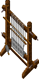 Loom (south)           | 85 Boards or Logs 25 Cloth |   no    | 84.2 Carpentry 65.0 Tailoring |

=== "Cooking"

    |                                    Item                                    |            Resources            | Dyeable |              Skill               |
    |:--------------------------------------------------------------------------:|:-------------------------------:|:-------:|:--------------------------------:|
    |    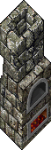 Stone Oven (east)    | 85 Boards or Logs 125 Ingots |   no    | 68.4 Carpentry 50.0 Tinkering |
    |   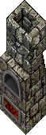 Stone Oven (south)   | 85 Boards or Logs 125 Ingots |   no    | 68.4 Carpentry 50.0 Tinkering |
    |    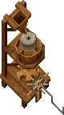 Flour Mill (east)    | 100 Boards or Logs 50 Ingots |   no    | 94.7 Carpentry 75.0 Tinkering |
    |   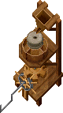 Flour Mill (south)   | 100 Boards or Logs 50 Ingots |   no    | 94.7 Carpentry 75.0 Tinkering |
    |  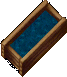 Water Trough (east)  |       150 Boards or Logs        |   no    |          94.7 Carpentry          |
    | 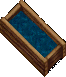 Water Trough (south) |       150 Boards or Logs        |   no    |          94.7 Carpentry          |

## Runic saws

Runic Saws are obtained through BOD rewards, the enchantments only apply to weapons.

!!! warning
Section under construction.

## Masonry

To learn Masonry, you will need the Masonry book and the four missing pages.

The Masonry book can be purchased from the Stone Crafter NPC in Occlo (3675, 2544).

The missing pages can be looted from Stone, Sandstone and Marble Elementals, which can spawn when using a [Gargoyle Pickaxe](../resource-gathering/mining.md#gargoyle-pickaxe).

Once learned, Masonry allows you to use the Mallet and Chisel tool, available from the Stone Crafter NPC.

### Materials

Stonework takes the color of the granite (stone) used to make it. Stone, sandstone and marble blocks don't change the color.

#### Types of stone

Stones can be gathered with [Mining](../resource-gathering/mining.md#types-of-stone), but the ability must be learned first.

The book Mining for Quality Stone is available from the Stone Crafter NPC.

You can choose to mine for stone and ore by single-clicking your mining tool.

|                                 Stone                                  |                Hue                |
| :--------------------------------------------------------------------: | :-------------------------------: |
|              Stone             |                 -                 |
|  Dull Copper Stone | [2419](../../hues/hue.md?id=2419) |
|       Shadow Stone      | [2406](../../hues/hue.md?id=2406) |
|       Copper Stone      | [2413](../../hues/hue.md?id=2413) |
|       Bronze Stone      | [2418](../../hues/hue.md?id=2418) |
|       Golden Stone      | [2213](../../hues/hue.md?id=2213) |
|      Agapite Stone     | [2425](../../hues/hue.md?id=2425) |
|       Verite Stone      | [2207](../../hues/hue.md?id=2207) |
|     Valorite Stone    | [2219](../../hues/hue.md?id=2219) |

#### Stone blocks

Stone Blocks can be looted from Stone, Sandstone and Marble Elementals, which can spawn when using a [Gargoyle Pickaxe](../resource-gathering/mining.md#gargoyle-pickaxe).

|                            Stone Block                             |
| :----------------------------------------------------------------: |
|      Stone Block     |
|  Sandstone Block |
|     Marble Block    |

### Masonry crafting

=== "Decorations"

    |    Item    |          Resources           | Retains Color | Skill |
    |:----------:|:----------------------------:|:-------------:|:-----:|
    |    Vase    |           1 Stones           |      yes      | 52.5  |
    | Large Vase |           3 Stones           |      yes      | 52.5  |
    |  Fountain  | 100 Stones 4 Stone Blocks |      no       | 75.0  |
    |      Sandstone Fountain       | 100 Stones 4 Sandstone Blocks |      yes      | 75.0  |
    |           Small Urn           |             3 Stones             |      yes      | 82.0  |
    |     Small Tower Sculpture     |             3 Stones             |      yes      | 82.0  |

=== "Furniture"

    |              Item              |           Resources            | Retains Color | Skill |
    |:------------------------------:|:------------------------------:|:-------------:|:-----:|
    |          Stone Chair           |   4 Stones 1 Stone Blocks   |      yes      | 55.0  |
    |          Stone Bench           |   6 Stones 1 Stone Blocks   |      yes      | 65.0  |
    |   Medium Stone Table (east)    |   6 Stones 2 Stone Blocks   |      yes      | 65.0  |
    |   Medium Stone Table (south)   |   6 Stones 2 Stone Blocks   |      yes      | 65.0  |
    | Medium Sandstone Table (east)  | 6 Stones 2 Sandstone Blocks |      yes      | 65.0  |
    | Medium Sandstone Table (south) | 6 Stones 2 Sandstone Blocks |      yes      | 65.0  |
    | Medium Sandstone Table (east)  | 6 Stones 2 Sandstone Blocks |      yes      | 65.0  |
    | Medium Sandstone Table (south) | 6 Stones 2 Sandstone Blocks |      yes      | 65.0  |
    |   Medium Marble Table (east)   |  9 Stones 3 Marble Blocks   |      yes      | 75.0  |
    |  Medium Marble Table (south)   |  9 Stones 3 Marble Blocks   |      yes      | 75.0  |

=== "Hearths & Stoves"

    |                  Item                  |             Resources             | Retains Color | Skill | Cooking |
    |:--------------------------------------:|:---------------------------------:|:-------------:|:-----:|:-------:|
    |                Fire Pit                |             5 Stones              |      yes      | 60.0  |  Cook   |
    |              Stone Stove               |    10 Stones 2 Stone Blocks    |      yes      | 70.0  | Cook, Bake |
    |     Sandstone Oven (east / south)      |  15 Stones 3 Sandstone Blocks  |      yes      | 75.0  | Cook, Bake |
    |     Stone Fireplace (east / south)     |    20 Stones 4 Stone Blocks    |      yes      | 80.0  |  Cook   |
    |  Grey Brick Fireplace (east / south)   |    20 Stones 4 Stone Blocks    |      yes      | 80.0  |  Cook   |
    |   Sandstone Fireplace (east / south)   |  20 Stones 4 Sandstone Blocks  |      yes      | 80.0  |  Cook   |
    |      Stone Hearth (east / south)       |    25 Stones 5 Stone Blocks    |      yes      | 90.0  |  Cook   |

=== "Monuments"

    |                              Item                              |            Resources             | Retains Color | Skill |
    |:--------------------------------------------------------------:|:--------------------------------:|:-------------:|:-----:|
    | Arched Headstone Rounded, Slate, Rose and Grey Gravestones  |    6 Stones 1 Stone Block     |      yes      | 55.0  |
    | Carved and Weathered Gravestones Narrow, Dark Narrow and Small Tablet Gravestones | 6 Stones 1 Stone Block | yes | 60.0 |
    |             Twin, Tablet and Engraved Gravestones              |    8 Stones 1 Stone Block     |      yes      | 65.0  |
    |                    Sandstone Twin Gravestone                   |  8 Stones 1 Sandstone Block   |      yes      | 65.0  |
    |                       Ornate Gravestone                        |    8 Stones 2 Stone Blocks    |      yes      | 70.0  |
    |                           Tomb Slab                            |   10 Stones 2 Stone Blocks    |      yes      | 70.0  |
    |                     Blue Marble Tomb Slab                      |   10 Stones 2 Marble Blocks   |      yes      | 70.0  |
    |                         Grave Obelisk                          |   12 Stones 2 Stone Blocks    |      yes      | 80.0  |
    |                         Stone Monument                         |   15 Stones 3 Stone Blocks    |      yes      | 80.0  |
    |                         Marble Memorial                        |   15 Stones 3 Marble Blocks   |      yes      | 85.0  |
    |                           Stone Spire                          |   15 Stones 3 Stone Blocks    |      yes      | 85.0  |

=== "Columns & Pedestals"

    |         Item          |            Resources            | Retains Color | Skill |
    |:---------------------:|:-------------------------------:|:-------------:|:-----:|
    |    Stone Pedestal     |    5 Stones 1 Stone Block    |      yes      | 60.0  |
    | Small Marble Pedestal |   4 Stones 1 Marble Block    |      yes      | 60.0  |
    |   Sandstone Column    | 10 Stones 2 Sandstone Blocks |      yes      | 70.0  |
    |     Marble Column     |  10 Stones 2 Marble Blocks   |      yes      | 75.0  |

- You can cook on the fire pit, fireplaces and hearths, and bake in the sandstone ovens and the stone stove.
- Hearths, stoves and fireplaces keep their color when turned back into a deed.
- Most monuments and columns, and the stone stove, can be flipped with an [Interior Decorator](../../game-mechanics/housing.md#tools) to face another direction or show another style. Hearths, ovens and fireplaces come in separate east and south versions instead.

## Bulk order deeds

A minimum skill of 70.1 (real) is required to get a BOD.

You must have 85.1 (real) or higher for a chance to get a large BOD.

The BOD 6-hour time limit applies to your whole account.

### BOD Rewards

| Points |                                                                                Rewards                                                                                |
| :----: | :-------------------------------------------------------------------------------------------------------------------------------------------------------------------: |
|   0    |                                                                   Sturdy Dovetail Saw (180) (100%)                                                                    |
|   50   |                                                                   Sturdy Dovetail Saw (220) (100%)                                                                    |
|  100   |                                                                Sturdy Lumberjack Axe (250 uses) (100%)                                                                |
|  150   |                                                                Sturdy Lumberjack Axe (300 uses) (100%)                                                                |
|  175   |                                                        HeartwoodOil (15 uses) (75%) Woodwarden's Axe (25%)                                                         |
|  200   |                                                        HeartwoodOil (25 uses) (60%) Woodwarden's Axe (40%)                                                         |
|  300   |                                      Empty Hanging Shelf (33.33%) Carpenter's Crate (33.33%) Carpenter's Mask Dye (33.33%)                                      |
|  400   |                                             Empty Writing Desk (40%) Writing Desk (40%) Cart Of Tools (deco) (20%)                                              |
|  450   |                                               Bookcases (60%) Special Bookcases (20%) Player Bulletin Board (20%)                                               |
|  500   |                                 Furniture Dye Tub (5 charges) (66.67%) Grandfather Clock (16.67%) Cart Of Tools (deco) (16.67%)                                 |
|  525   |                                  Furniture Dye Tub (5 charges) (50%) Runic Saw (oak) (33.33%) Carpenter's Apron (+5) (16.67%)                                   |
|  550   |                                          Display Cases (1 of 6) (60%) Runic Saw (ash) (30%) Carpenter's Mask Dye (10%)                                          |
|  600   | House Increases (50% chance for +20 lockdown or +1 secure) (60%) Runic Saw (yew) (30%) House Increases (50% chance for +30 lockdown or 50% for +2 secure) (10%) |

## Training

Consider Lumberjacking to fund the training.

| Skill       | Item            |
| ----------- | --------------- |
| 0 - 30      | Train from NPCs |
| 30 - 47.3   | Medium Crate    |
| 47.3 - 71.1 | Ballot Box      |
| 71.1 - 75   | Fishing Pole    |
| 75 - 87     | Quarter Staff   |
| 87 - 100    | Gnarled Staff   |

While training this skill you can also gain Strength (primary) and Dexterity (secondary). Visit the [stats](../../game-mechanics/character/stats.md) page to learn more.

## Related skills

- [Lumberjacking](../resource-gathering/lumberjacking.md)
- [Tailoring](../crafting/tailoring.md)
- [Blacksmithing](../crafting/blacksmithy.md)
- [Tinkering](../crafting/tinkering.md)
- [Musicianship](../bard-skills/musicianship.md)
- [Magery](../magic/magery.md)
- [Mining](../resource-gathering/mining.md)
