{ align=right }

# Animal Taming

## Overview

Animal Taming allows you to befriend wild creatures and command them in combat.

Starting items if you choose this skill in character creation: Shepherds Crook.

## Stable slots

The amount of available stable slots is determined by the total Animal Taming, Animal Lore and Veterinary of the player, for a max of 30 slots.

Every player has a minimum of 5 slots regardless of skill.

## Taming requirements

Anyone can tame a Horse regardless of skill.

Creatures that require a skill of 29.1 or less will follow anyone's orders.

High Animal Taming and Animal Lore will help controlling harder creatures, a check is made by comparing the required taming level to 70% Taming plus 30% Lore of the player.

Dragons, Drakes and Nightmare have the Fire Breath ability, proportionate to their remaining HP.

This table shows the minimum skill required to start taming, the damage only shows melee without considering magery and fire breath.

??? note "Click to expand: Taming requirements"

    |                               Creature                               | Skill | Base Damage |    HP     | AR  |
    |:--------------------------------------------------------------------:|:-----:|:-----------:|:---------:|:---:|
    |              Cat             | -0.9  |      1      |     6     |  8  |
    |          Chicken         | -0.9  |      1      |     3     |  2  |
    |    Mountain Goat   | -0.9  |    3 - 7    |  20 - 33  | 10  |
    |              Rat             | -0.9  |    1 - 2    |     6     |  6  |
    |        Sewer Rat       | -0.9  |    1 - 2    |     6     |  6  |
    |              Dog             | -15.3 |    4 - 7    |  17 - 22  | 12  |
    |          Gorilla         | -18.9 |   4 - 10    |  38 - 51  | 20  |
    |      Jack Rabbit     | -18.9 |    1 - 2    |     9     |  4  |
    |          Mongbat         | -18.9 |    1 - 2    |   4 - 6   | 10  |
    |           Rabbit          | -18.9 |      1      |   4 - 6   |  6  |
    |             Crow            | -6.9  |      0      |    10     |  -  |
    |           Magpie          | -6.9  |      0      |    10     |  -  |
    |            Raven           | -6.9  |      0      |    10     |  -  |
    |    Tropical Bird   | -6.9  |      0      |    10     |  -  |
    |             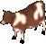 Cow             | 11.1  |    1 - 4    |    18     | 10  |
    |            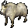 Goat            | 11.1  |    3 - 4    |    12     | 10  |
    |      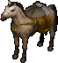 Pack Horse      | 11.1  |   5 - 11    |  61 - 80  | 16  |
    |       Pack Llama      | 11.1  |    2 - 6    |    50     | 16  |
    |              Pig             | 11.1  |    2 - 4    |    12     | 12  |
    |           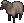 Sheep           | 11.1  |    1 - 2    |    12     |  6  |
    |            Eagle           | 17.1  |   5 - 10    |  20 - 27  | 22  |
    |        Bull Frog       | 23.1  |    1 - 2    |  28 - 42  |  6  |
    |             Hind            | 23.1  |      4      |  15 - 29  |  8  |
    |            Slime           | 23.1  |    1 - 5    |  15 - 19  |  8  |
    |      Timber Wolf     | 23.1  |    5 - 9    |  34 - 48  | 16  |
    |             Boar            | 29.1  |    3 - 6    |    15     | 10  |
    |   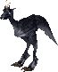 Forest Ostard   | 29.1  |   8 - 14    |  71 - 88  |  -  |
    |        Giant Rat       | 29.1  |    4 - 8    |  26 - 39  | 18  |
    |           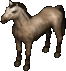 Horse           | 29.1  |    3 - 4    |  28 - 45  |  -  |
    |    Ridable Llama   | 29.1  |    3 - 5    |  15 - 27  |  -  |
    |       Black Bear      | 35.1  |   4 - 10    |  46 - 60  | 24  |
    |           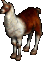 Llama           | 35.1  |    3 - 5    |  15 - 27  | 16  |
    |       Polar Bear      | 35.1  |   7 - 12    |  70 - 84  | 18  |
    |           Walrus          | 35.1  |   4 - 10    |  14 - 17  | 18  |
    |       Brown Bear      | 41.1  |   6 - 12    |  46 - 60  | 24  |
    |          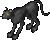 Cougar          | 41.1  |   4 - 10    |  34 - 48  | 16  |
    |       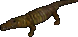 Alligator       | 47.1  |   5 - 15    |  46 - 60  | 30  |
    |         Scorpion        | 47.1  |   5 - 10    |  50 - 63  | 28  |
    |       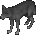 Grey Wolf       | 53.1  |    3 - 7    |  34 - 48  | 16  |
    |          Panther         | 53.1  |   4 - 12    |  37 - 51  | 16  |
    |     Snow Leopard    | 53.1  |    3 - 9    |  34 - 48  | 24  |
    |     Giant Spider    | 59.1  |   5 - 13    |  46 - 60  | 16  |
    |       Great Hart      | 59.1  |    5 - 9    |  27 - 41  | 24  |
    |     Grizzly Bear    | 59.1  |   8 - 13    |  76 - 93  | 24  |
    |            Snake           | 59.1  |    1 - 4    |  15 - 19  | 16  |
    |      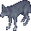 White Wolf      | 65.1  |    3 - 7    |  34 - 48  | 16  |
    |             Bull            | 71.1  |    4 - 9    |  50 - 64  | 28  |
    |  Greater Mongbat | 71.1  |    5, 7     |  34 - 48  | 10  |
    |         Hell Cat        | 71.1  |   6 - 12    |  48 - 67  | 30  |
    |     Frost Spider    | 74.7  |   6 - 16    |  46 - 60  | 28  |
    | 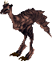 Frenzied Ostard | 77.1  |   11 - 17   | 71 - 110  |  -  |
    |      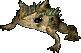 Giant Toad      | 77.1  |   5 - 17    |  46 - 60  | 24  |
    |     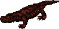 Lava Lizard     | 80.7  |   6 - 24    |  76 - 90  | 40  |
    |        Dire Wolf       | 83.1  |   11 - 17   |  58 - 72  | 22  |
    |             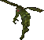 Imp             | 83.1  |   10 - 14   |  55 - 70  | 30  |
    |           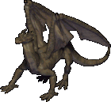 Drake           | 84.3  |   11 - 17   | 401 - 430 | 46  |
    |       Hell Hound      | 85.5  |   11 - 17   | 66 - 125  | 30  |
    |          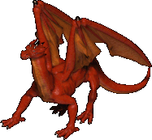 Dragon          | 93.9  |   16 - 22   | 796 - 825 | 60  |
    |       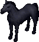 Nightmare       | 95.1  |   16 - 22   | 296 - 315 | 60  |
    |      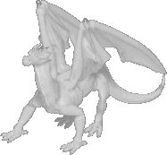 White Wyrm      | 96.3  |   17 - 25   | 721 - 760 | 64  |

Even at GM, you still have a 5% chance of successfully taming a Dragon, White Wyrm or Drake. The message "You seem to anger the Beast" will reflect that.

## Nightmares

Nightmares spawn on a timer between 12 and 24 hours in specific locations only.

The coordinates show only the general spawn areas, not exact locations.

- Covetous lvl 5, Coordinates 5453, 1802.
- Fire lvl 2, Coordinates 5723, 1334.
- Shame lvl 5, Coordinates 5666, 13.
- Temple island, Coordinates 2493, 3590.
- Hedge Maze, Coordinates 1146, 2215.

## Bonding

All players start with one bond slot. Feed the pet you want to bond, after the message "You begin bonding with your pet." appears, stable the pet for 24 hours and then feed it again to bond it.

Bonded pets can recall with you.

### Bond slots

You can gain additional bond slots by completing the [Animal Bonding Quest](../../custom-systems/animal-bonding-quest.md).

At 80 Animal Taming you will able to accept the quest at the Moonglow Zoo located at these coordinates (4540, 1367).

To complete the quest you will need to find and tame various rare animals.

For more information visit the [Animal Bonding Quest](../../custom-systems/animal-bonding-quest.md) page.

### Pet retrieval

If you have lost your bonded pet, you can retrieve it at the Rangers Guild outside Skara Brae, at these coordinates (747, 2155).

Say `Find my pets` near the NPCs to use the service, the fee for retrieving a lost pet is 3.000 gold.

## Training

While training Taming you can also gain Animal Lore.

| Skill       | Tame                 | Location    |
|-------------|----------------------|-------------|
| 0 - 30      | Train from NPCs      |             |
| 35.1 - 53.1 | Walrus Polar Bear | Dagger Isle |
| 53.1 - 65.1 | Snow Leopard         | Dagger Isle |
| 65.1 - 71.1 | White Wolf           | Dagger Isle |
| 71.1 - 85.5 | Bull                 | Jhelom      |
| 85.5 - 100  | Hell Hound           | Hythloth    |

While training this skill you can also gain Strength (primary) and Intelligence (secondary). Visit the [stats](../../game-mechanics/character/stats.md) page to learn more.

## Related skills

- [Animal Lore](animal-lore.md)
- [Veterinary](veterinary.md)
