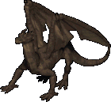
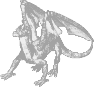
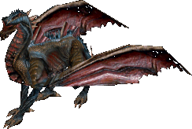

# Destard

## Dungeon Dye

Monsters inside a dungeon have a rare chance to drop a [Dungeon Dye Material](../../custom-systems/dungeon-dyes.md), each dungeon has its own dye.

| Dye Material      | Dye Name           | Hue                               |
|-------------------|--------------------|-----------------------------------|
| Dragon Blood Opal | Dragon's Scale Red | [2139](../../hues/hue.md?id=2139) |

## Entrance

Coordinates 1176, 2637.

## Level 1

|                                 Mobs                                 |                                                              |                                                    |
|:--------------------------------------------------------------------:|:------------------------------------------------------------:|:--------------------------------------------------:|
|           Dragon          |        Drake       |  Wyvern |
|  Water Elemental |  Giant Snake |                                                    |

### Rikktor

Destard is the home of the [Rikktor](../champions/rikktor.md) champion.

## Level 2

|                        Mobs                        |                                                              |
|:--------------------------------------------------:|:------------------------------------------------------------:|
|  Daemon |  Shadow Wyrm |
|   Drake  |    Evil Mage   |

## Level 3

|                                Mobs                                |                                                              |
|:------------------------------------------------------------------:|:------------------------------------------------------------:|
|    Ancient Wyrm   |       Wyvern      |
|  Fire Elemental |  Giant Snake |
